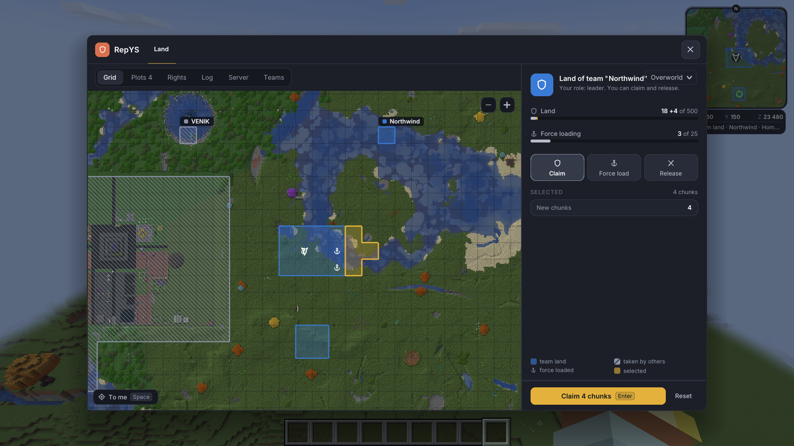

# RYSClaims

*Русская версия ниже: [по-русски](#по-русски).*



**Chunk-based land claims.** A team claims land, keeps it force-loaded and decides who can do what. Protection stops not only players but also other mods' machines. Land from FTB Chunks moves over with its force-loading, rights and limits, and the import can be rolled back until the land has been edited.

## Features

- the Land window with a chunk grid
- chunk force-loading
- rights by role, for allies and for trusted players
- protection from players, explosions, mobs and foreign machines
- plots with their own rights, transfer and lease
- a log of attempts on your land
- limits and server rules in the operator window

The same actions are available as `/claims` commands. An operator does not bypass claims until they turn on `/claims admin bypass`.

## Requirements

- Minecraft 1.21.1, NeoForge 21.1.x, client and server.
- No other mods required.
- Optional: RYSTeams (teams, roles and alliances), RYSMap (land on the map and minimap).
- Languages: English and Russian.

## Download and help

- Download: [CurseForge](https://www.curseforge.com/minecraft/mc-mods/rysclaims).
- Help, ideas and questions: [Discord](https://discord.gg/Tqgy7acmyd).
- Bugs: [GitHub Issues](https://github.com/MityaKr/RYSClaims/issues).

## Documentation

- [docs/data.md](docs/data.md): where the land is stored, limits, force-loading, rights and the import from FTB Chunks.

The documents are in Russian.

## The RYS family

RYSClaims is part of the RYS family of mods: one style, shared themes and settings. Each mod works on its own, and together they complement each other.

- [RYSQuests](https://www.curseforge.com/minecraft/mc-mods/rysquests), a quest book with guides and a shop.
- [RYSIndex](https://www.curseforge.com/minecraft/mc-mods/rysindex), a recipe viewer with crafting trees.
- [RYSMap](https://www.curseforge.com/minecraft/mc-mods/rysmap), a world map and minimap.
- [RYSTeams](https://www.curseforge.com/minecraft/mc-mods/rysteams), player teams with roles and alliances.
- [RYSHelm](https://www.curseforge.com/minecraft/mc-mods/ryshelm), the Server window for admins.

## Building from source

You need Java 21. The build takes the family's shared code from the [RYSCore](https://github.com/MityaKr/RYSCore) repository, which must sit next to this one and be published to its local `repo/` folder first:

```
git clone https://github.com/MityaKr/RYSCore
git clone https://github.com/MityaKr/RYSClaims
cd RYSCore && ./gradlew publish
cd ../RYSClaims && ./gradlew build
```

The jar is in `build/libs`.

## License

The code is under [MPL-2.0](LICENSE). The graphics and the RYS name remain with the author, see [NOTICE.md](NOTICE.md). You can include the mod in any modpack without asking for permission.

Author: MityaYS, RepkaWorks.

---

## По-русски

**Приват земли по чанкам.** Команда занимает землю, включает ей прогрузку и решает, кому что можно. Защита держит не только игроков, но и машины других модов. Земля из FTB Chunks переезжает вместе с прогрузкой, правами и лимитами, а перенос можно откатить, пока землю не начали править.

### Возможности

- окно «Земля» с сеткой чанков
- прогрузка чанков
- права по ролям, союзникам и доверенным игрокам
- защита от игроков, взрывов, мобов и чужих машин
- участки со своими правами, передачей и арендой
- журнал попыток на твоей земле
- лимиты и правила сервера в окне оператора

Те же действия есть командами `/claims`. Оператор не обходит приват, пока сам не включит `/claims admin bypass`.

### Требования

- Minecraft 1.21.1, NeoForge 21.1.x, клиент и сервер.
- Других модов не требует.
- По желанию: RYSTeams (команды, роли и союзы), RYSMap (земля на карте и миникарте).
- Языки: русский и английский.

### Скачать и спросить

- Скачать: [CurseForge](https://www.curseforge.com/minecraft/mc-mods/rysclaims).
- Помощь, идеи и вопросы: [Discord](https://discord.gg/Tqgy7acmyd).
- Баги: [GitHub Issues](https://github.com/MityaKr/RYSClaims/issues).

### Документация

- [docs/data.md](docs/data.md): где хранится земля, лимиты, прогрузка, права и перенос из FTB Chunks.

### Семья RYS

RYSClaims входит в семью модов RYS: один стиль, общие темы и настройки. Каждый мод работает сам по себе, а вместе они дополняют друг друга.

- [RYSQuests](https://www.curseforge.com/minecraft/mc-mods/rysquests), книга квестов с гайдами и магазином.
- [RYSIndex](https://www.curseforge.com/minecraft/mc-mods/rysindex), справочник рецептов с деревом крафта.
- [RYSMap](https://www.curseforge.com/minecraft/mc-mods/rysmap), карта мира и миникарта.
- [RYSTeams](https://www.curseforge.com/minecraft/mc-mods/rysteams), команды игроков с ролями и союзами.
- [RYSHelm](https://www.curseforge.com/minecraft/mc-mods/ryshelm), окно «Сервер» для администраторов.

### Сборка из исходников

Нужна Java 21. Общий код семьи сборка берёт из репозитория [RYSCore](https://github.com/MityaKr/RYSCore): он должен лежать рядом с этим и сначала выложиться в свою папку `repo/` командой `gradlew publish` (команды выше). Готовый jar лежит в `build/libs`.

### Лицензия

Код под [MPL-2.0](LICENSE), графика и имя RYS остаются за автором, подробности в [NOTICE.md](NOTICE.md). Мод можно включать в любую сборку без отдельного разрешения.

Автор: MityaYS, RepkaWorks.
